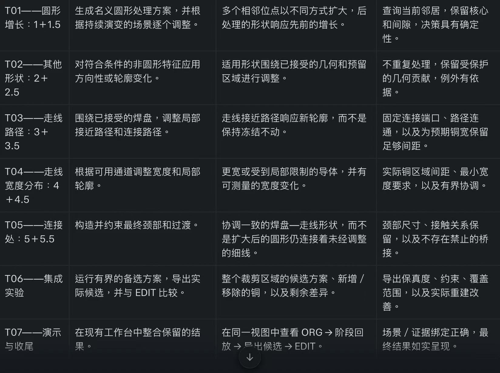

# GerbRev

Standalone CLI for the source-only Gerber U05 route. It processes one explicitly selected Gerber artwork file. Both passes construct and check T01 → T03 → T04 → T02 → T05. The first pass and its verified export produce the local reference. The second pass uses that reference and runs the connected-copper checks, export, paired actual-file reparse, corruption controls, and final material audit.

See the [performance handoff](docs/PERFORMANCE_HANDOFF.md) for this branch's changes and qualification steps.

## Workflow reference



## Run

The tested setup uses Python 3.14.5 on Apple Silicon macOS with the pinned wheels in `requirements.lock`. The geometry runtime checks Shapely and GEOS 3.13.1. Use a writable workspace with at least 5 GiB free.

```sh
git clone https://github.com/jiefengcheng/GerbRev.git
cd GerbRev
python3.14 -m venv .venv
.venv/bin/python -m pip install --only-binary=:all: -r requirements.lock
.venv/bin/python -m pip check
./u05 --help
./u05-view --help
```

Start with the [synthetic trial suite](#synthetic-trial-cases). To run one selected Gerber, create a workspace outside its input directory, then supply both paths:

```sh
./u05 --trial /absolute/input/top.art.gbr --workspace /absolute/workspace
```

`U05_PYTHON` can select an existing compatible Python interpreter by absolute path. The CLI inventories the input directory for source custody and any source-bound artwork scope policy. It writes the selected Gerber and a 9360 × 6480 comparison PNG into a timestamped sibling directory. The workspace retains worker logs, policy snapshots, stage receipts, the actual-file checks and the delivery receipt. On a failure the job records `HALTED` and retains the evidence. T05 records its search decisions periodically. Cross-job checkpoint adoption is outside this standalone command.

The source, stage and proof files are bound by digests. The bundled runtime policy files also have a checked inventory. The public checkout includes the generic rules and synthetic examples. Source-specific declarations start empty in this edition. Electrical intent, manufacturing approval and independent review are outside the CLI's qualification.

## Five-minute trial

```sh
./u05 --trial /absolute/input/top.art.gbr --workspace /absolute/workspace
```

Trial mode runs both passes with the same checks and outputs. If the job is still running after five minutes, the CLI stops the coordinator and its worker processes, records the last reported phase and completed checks in `TRIAL_TIMEOUT.json` under the job directory, and exits with code `124`. The job directory and logs remain available for inspection.

## Smoke qualification

Copy `tests/synthetic_top.gbr` to a fresh input directory beside a separate work directory, then run the CLI and capture stdout:

```sh
./u05 /absolute/smoke-input/top.art.gbr --workspace /absolute/smoke-work > /absolute/smoke-work/run.log
.venv/bin/python -B tests/check_smoke.py /absolute/smoke-work/run.log
```

The checker expects all 47 operations to pass, the exported synthetic Gerber to match the upstream byte digest, and the final PNG to match its receipt and the declared 4× dimensions. The fixture was generated for route qualification.

## Synthetic trial cases

From the repository root, after the Python setup in [Run](#run), copy and paste these commands to run all nine trials:

```sh
trial_workspace="${U05_TRIAL_WORKSPACE:-$PWD/out/u05-trials}"
mkdir -p "$trial_workspace"
PYTHONPATH="$PWD" .venv/bin/python -B tests/run_trials.py "$trial_workspace" --report
```

Allow **about 2 minutes 32 seconds** for the nine trials based on a measured sequential run on the development Mac. Setup and HTML generation are separate. The workspace needs at least 5 GiB free. Set `U05_TRIAL_WORKSPACE` before running the commands to use a different directory.

| Gerber | What it exercises | Gerber and render |
| --- | --- | --- |
| `round_and_junction.gbr` | T01 round-pad growth and buried-circle KEEP, plus T05 junction growth | Both |
| `parallel_clearance.gbr` | T03 trace retention and T04 widening limited by clearance and the total-width cap | Both |
| `rectangle_terminal.gbr` | T02 growth of a short square-aperture draw assigned to T02 in the catalogue | Both |
| `ordered_polarity.gbr` | Clear gap and later dark copper island survive final export and reparse | Both |
| `no_round_pads.gbr` | Expected T01 halt with `NO_SOURCE_LANDS` | No files |
| `leading_arc_no_rectangles.gbr` | Standard leading-zero 4.6 input, a retained native arc and verified empty T02 inventory | Both |
| `tight_parallel_keep.gbr` | Both 41 µm-gap traces stay at their original widths through both T04 passes | Both |
| `missing_eof.gbr` | Expected source-assembly rejection of truncated Gerber | No files |
| `clear_clipped_trace.gbr` | Expected source-assembly halt with `CLEAR_CLIPPED_TRACE_NEEDS_SEPARATE_FAMILY` | No files |

List the cases without running U05, or select just the cases you need:

```sh
.venv/bin/python -B tests/run_trials.py --list
PYTHONPATH="$PWD" .venv/bin/python -B tests/run_trials.py "$trial_workspace" \
  --case leading_arc_no_rectangles --case missing_eof --report
```

Each delivery passes all 47 operations and writes `top.art.gbr` and `final_render.png` in its own `input_U05_040mm_*` directory. An expected halt counts as a passed trial when its stage and diagnostic match. Every case has a five-minute deadline and keeps its logs.

The runner continues through the selected cases and returns a nonzero exit code if any expectation fails. It writes `SUITE.json` with the actual outcome, phase, timing and log paths for each case. `--report` also writes a sibling HTML report and prints its path.

## View saved jobs and suites

`./u05-view` creates an offline HTML report in a new directory outside the saved input. It accepts one job directory, its `STATUS.current.json`, or the trial suite directory printed by the runner. It reads saved evidence and writes only the new report. Opening a report does not run the U05 pipeline.

From the repository root, set `suite_dir` to the path printed by the trial runner:

```sh
suite_dir='/absolute/path/to/u05_synthetic_trials.XXXXXXXX'
./u05-view "$suite_dir" --output "${suite_dir}-view" --open
```

The suite index shows each case, its recorded status, the number of checks passed, and whether a delivery was recorded. Suites with `SUITE.json` also show the trial verdict and run time. Each job page includes:

- Original and assembled source copper, the source catalogue and input records.
- T01, T03, T04, T02 and T05 for both passes. Each completed stage shows its entry and result on common coordinates, with new copper in green, removed copper in pink, and a close-up of the largest change. The full decision records, reconstruction receipts and worker logs are linked.
- The first-pass export, local remedy reference, final Gerber and reparse receipts, corruption outcomes, and saved render gallery.
- The exact failed or timed-out stage when a job stops, with the available diagnostics and no delivery claim.

To open one job, including a halted job, supply its job directory:

```sh
job_dir='/absolute/workspace/operator_routes/gerber_u05/job-id'
./u05-view "$job_dir" --output "${job_dir}-view" --open
```

Use `--links-only` on a large job to browse its existing pictures, receipts and logs without building stage previews:

```sh
./u05-view "$job_dir/STATUS.current.json" --output "${job_dir}-links" --links-only
```

Omit `--open` to print the report's `index.html` path for later use. `U05_PYTHON` selects an alternate pinned interpreter, just as it does for `u05`. Keep the saved job or suite alongside the report because its evidence links point to those files.

### Check the viewer

With a completed full suite and a retained timeout job, the following checks the generated reports, local links, stage SVGs, and evidence preservation:

```sh
timeout_job='/absolute/workspace/operator_routes/gerber_u05/timed-out-job-id'
.venv/bin/python -B tests/check_view.py "$suite_dir" "$timeout_job" "$trial_workspace"
```
